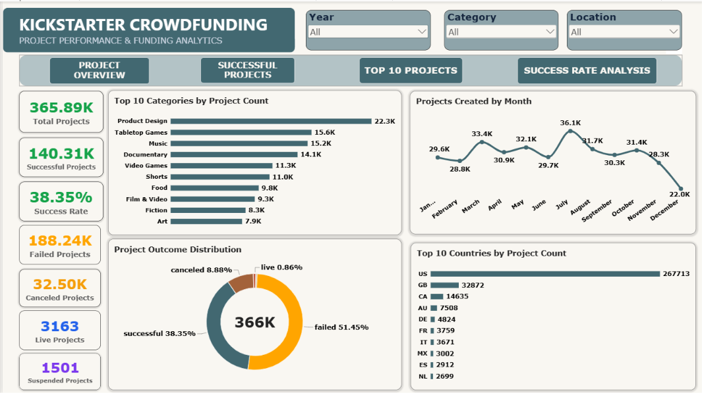
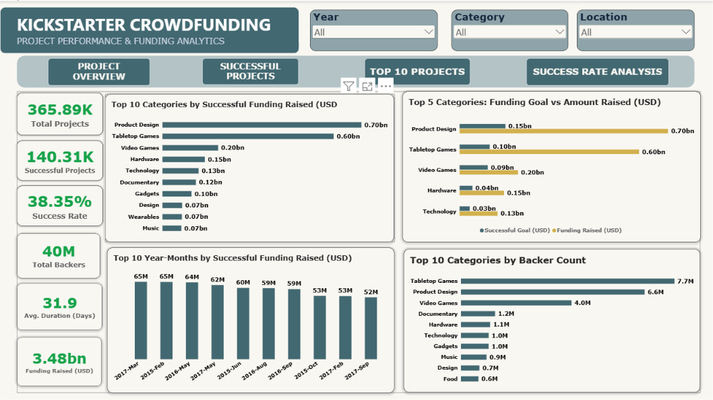
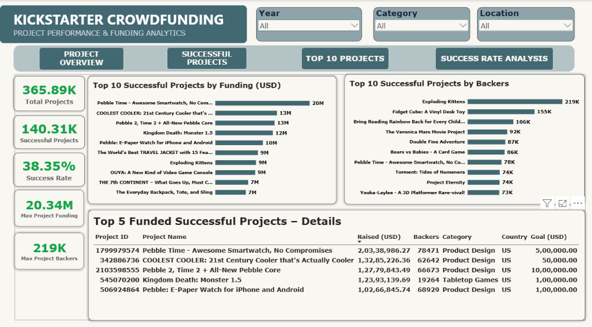
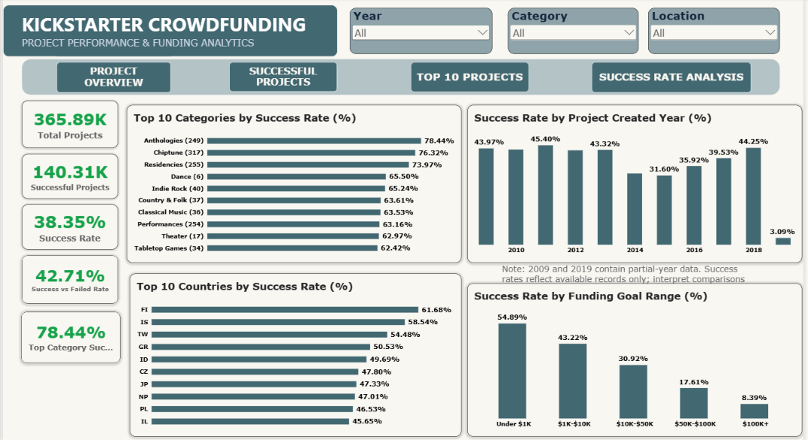
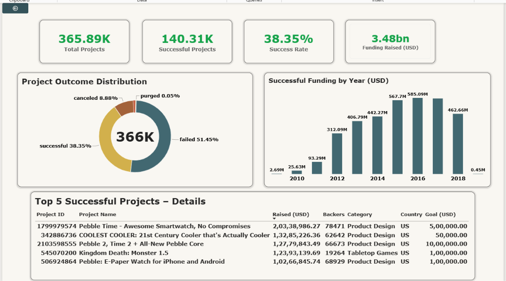
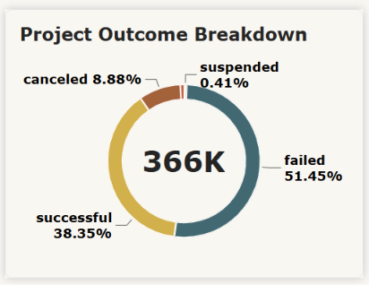

# Kickstarter Crowdfunding Analysis Dashboard | Power BI

## Project Overview

An interactive **Power BI crowdfunding analytics dashboard** exploring Kickstarter project outcomes, successful funding, leading categories and projects, and success rates across years, countries, and funding-goal ranges. Navigation uses **Power BI bookmarks** with drillthrough and report tooltips for deeper analysis.

## Dashboard KPIs

The following values are visible in the unfiltered overview screenshot (rounded figures):

| KPI | Value |
| --- | ---: |
| Total Projects | 365.89K |
| Successful Projects | 140.31K |
| Overall Success Rate | 38.35% |
| Successful Funding Raised (USD) | $3.48B (approx.) |

> Values can change based on report filters. The funding metric is taken from the successful-project analysis view.

## Tools & Technologies

- Microsoft Power BI Desktop
- Power Query for data preparation
- DAX measures and KPI calculations
- Data modeling and interactive visualizations
- Bookmarks, slicers, drillthrough, and report page tooltips

## Report Views

### 1. Project Overview
- Project counts and status breakdown (successful, failed, canceled, live, suspended)
- Top categories and countries by project count
- Monthly project creation trend

### 2. Successful Projects
- Successful funding raised by category and year-month
- Funding goals versus amount raised
- Backers by category and overall funding KPIs

### 3. Top 10 Projects
- Top successful projects ranked by pledged funding and backer count
- Detailed table of five leading funded projects
- Maximum project funding and backer KPIs

### 4. Success Rate Analysis
- Success rate by category, country, and project creation year
- Success rate by funding-goal range
- Partial-year note for 2009 and 2019

### Advanced Interactions
- **Category Deep Dive (drillthrough):** Detailed outcome analysis and project tables
- **Advanced Tooltip:** Project outcome breakdown displayed on hover
- **Bookmarks and slicers:** Page-style navigation and Year, Category, and Location filters

## Dashboard Screenshots

### 1. Project Overview

### 2. Successful Projects

### 3. Top 10 Projects

### 4. Success Rate Analysis

### 5. Category Deep Dive — Drillthrough

### 6. Advanced Tooltip

## How to Use

1. Download `power bi project.pbix` from this repository’s **Releases** section, or clone with Git LFS if the `.pbix` is tracked there.
2. Open it with **Microsoft Power BI Desktop**.
3. Use the navigation buttons to explore dashboard views.
4. Apply Year, Category, and Location filters; interact with visuals for drillthrough and tooltips.

## Download Power BI Project

[Download Kickstarter Crowdfunding Dashboard (.pbix)](https://github.com/Salman2005/Kickstarter-Crowdfunding-Analysis-Power-BI/releases/download/v1.0.0/power.bi.project.pbix)

Open the downloaded file using Microsoft Power BI Desktop.

> **Large file note:** The `.pbix` exceeds GitHub's 100 MiB regular Git limit. It can be shared as a downloadable **GitHub Release asset** (simplest browser-based option) or tracked with **Git LFS**. The screenshots and README are viewable directly on GitHub.

## Author

**Salman Idrisi**

*Portfolio project demonstrating Power BI data analysis and interactive dashboard design.*

